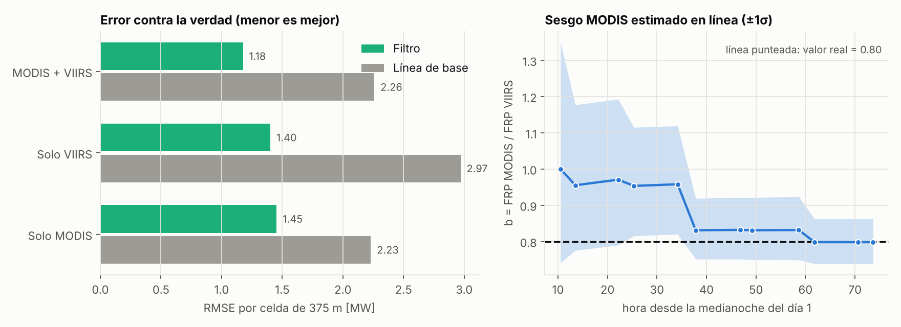

# Armonización MODIS–VIIRS con un filtro de Kalman por ensembles

Prototipo para el reto de NASA Space Apps de armonización de MODIS y VIIRS.
En vez de buscar una tabla de conversión entre sensores, mantiene un **estado
oculto del incendio** en una grilla de 375 m (potencia radiativa del fuego, FRP,
en MW por celda) y lo corrige con cada pasada satelital usando un **operador de
observación distinto para cada sensor**.

El resultado es un campo de FRP continuo en el tiempo, independiente del sensor
y con su incertidumbre.


## Qué hace

| Pieza | Archivo | Idea |
|---|---|---|
| Modelo de fuego | `frp_enkf/model.py` | Cada celda tiene FRP y combustible. El fuego se intensifica mientras queda combustible, se propaga a los vecinos (con viento y un umbral de ignición) y sigue un ciclo diurno. |
| Sensores | `frp_enkf/sensors.py` | Geometría real del píxel según el ángulo de barrido. MODIS pasa de 1 km en nadir a 4.8 × 2.0 km en el borde, con respuesta triangular. VIIRS pasa de 375 m a unos 0.8 km gracias a su agregación de muestras. El umbral de detección crece con el área del píxel. |
| LETKF | `frp_enkf/letkf.py` | Filtro de Kalman por ensembles con transformación local y localización de Gaspari-Cohn. |
| Fusión | `frp_enkf/assim.py` | Análisis en `log(FRP)`, no-detecciones como observaciones censuradas, encendido de fuego nuevo y estimación en línea del sesgo MODIS/VIIRS. |
| Experimento | `frp_enkf/osse.py` | Incendio sintético con verdad conocida, pasadas simuladas de Terra, Aqua, S-NPP y NOAA-20, y métricas. |
| Datos reales | `frp_enkf/firms.py` | Descarga de NASA FIRMS, lectura de los CSV, separación en pasadas y conversión de cada detección a su huella real. |

Tres decisiones separan esto de un EnKF de libro:

1. **Espacio logarítmico.** El FRP es positivo y muy asimétrico. El análisis se
   hace sobre `log(x + ε)`, así nunca aparecen MW negativos.
2. **La no-detección es un dato.** Un píxel despejado sin detección dice "el FRP
   está por debajo del umbral". Se asimila con un operador recortado en el
   umbral, que solo corrige a los miembros que predicen fuego detectable. Los
   píxeles nublados no aportan nada.
3. **El combustible sigue al fuego.** El LETKF aplica los mismos pesos locales
   al FRP y al combustible de cada celda, así que corregir dónde está el fuego
   corrige también qué queda por quemar.

Cuando llega un píxel MODIS grande, el filtro no lo deforma ni lo reparte
parejo. Lo compara con la integral del estado fino sobre esa huella, y la
covarianza del ensemble lleva la corrección a las celdas donde ya había fuego.


## Cómo correrlo

```bash
pip install -r requirements.txt
python run_osse.py            # ~1 minuto; escribe figures/ y figures/metrics.json
python -m pytest -q           # 25 tests
```

Opciones: `--seed`, `--members`, `--hours`, `--out`, `--no-figures`.
Conviene exportar `OMP_NUM_THREADS=1`: las matrices del filtro son chicas y los
hilos de BLAS lo hacen más lento.

## Resultados

Incendio sintético de 72 horas. El filtro arranca sin saber que hay fuego y usa
un modelo deliberadamente mal calibrado: tasas entre 10 y 17 % distintas de las
reales, viento distinto, máximo diurno una hora antes y un mapa de combustible
con error. La línea de base es el mapa grillado de la última pasada, mantenido
hasta la siguiente. Las métricas se miden desde 6 horas después de la primera
pasada.

Escenario por defecto (`--seed 7`, 50 miembros):

| Sensores | Método | RMSE a 375 m [MW] | RMSE a 1.5 km [MW] | Error medio del FRP total |
|---|---|---|---|---|
| MODIS + VIIRS | Filtro | **1.18** | **0.57** | **11.3 %** |
| MODIS + VIIRS | Línea de base | 2.26 | 1.49 | 33.0 % |
| Solo VIIRS | Filtro | 1.40 | 0.72 | 12.1 % |
| Solo VIIRS | Línea de base | 2.97 | 2.04 | 48.4 % |
| Solo MODIS | Filtro | 1.45 | 0.75 | 16.9 % |
| Solo MODIS | Línea de base | 2.23 | 1.46 | 41.5 % |

Lo mismo con otras tres semillas (filtro contra línea de base, MODIS + VIIRS):

| Semilla | RMSE a 375 m | Error del FRP total | Sesgo MODIS estimado (real: 0.80) |
|---|---|---|---|
| 7 | 1.18 contra 2.26 | 11.3 % contra 33.0 % | 0.80 |
| 1 | 1.15 contra 2.01 | 9.8 % contra 40.7 % | 0.80 |
| 2 | 1.34 contra 2.89 | 11.4 % contra 28.6 % | 0.79 |
| 3 | 1.36 contra 2.79 | 9.8 % contra 29.4 % | 0.82 |

Qué muestran:

- **Fusionar ayuda.** Con los dos sensores el error es menor que con cualquiera
  de los dos por separado, en las cuatro semillas.
- **El sesgo entre sensores se recupera.** MODIS se simula con un sesgo
  multiplicativo de 0.80. El filtro lo estima entre 0.79 y 0.82, con una
  incertidumbre declarada de 6 a 10 %. Tarda entre uno y dos días en converger.
- **La incertidumbre está bien calibrada.** La dispersión del ensemble es entre
  1.0 y 1.15 veces el error real.



## Datos reales de NASA FIRMS

`run_firms.py` baja las detecciones de MODIS y VIIRS de un rectángulo, las
separa en pasadas y corre el filtro. Hay tres formas de darle datos:

```bash
# últimos 7 días, sin clave (archivos globales de FIRMS)
python run_firms.py --bbox 144.35,-19.75,144.85,-19.25 --recent 7d

# cualquier fecha, con la MAP_KEY gratuita de FIRMS
export FIRMS_MAP_KEY=...      # https://firms.modaps.eosdis.nasa.gov/api/map_key/
python run_firms.py --bbox 144.35,-19.75,144.85,-19.25 --start 2026-11-08 --days 7

# sin red, con los CSV de muestra incluidos
python run_firms.py --bbox 144.35,-19.75,144.85,-19.25 --csv-dir data/queensland_2026-11
```

El rectángulo es `oeste,sur,este,norte` en grados. Escribe en `salida_firms/`
la serie de FRP total (`frp_armonizado.csv`), los campos horarios a 375 m
(`frp_armonizado.npz`), un resumen (`resumen.json`) y una figura. Las descargas
se guardan en `.firms_cache/`. Una corrida de 7 días sobre 50 × 55 km tarda
unos 5 minutos.

Qué hace con cada detección:

- **Huella real.** Usa las columnas `scan` y `track` de FIRMS como tamaño del
  píxel y lo orienta según la órbita del satélite.
- **Hora solar.** Convierte la hora UTC a hora solar local para el ciclo diurno.
- **No-detecciones inferidas.** FIRMS solo lista detecciones. Para cada pasada
  con al menos una detección se asume que el resto del rectángulo estaba
  despejado y sin fuego detectable. No hay máscara de nubes, así que estas
  observaciones entran con el doble de error. `--no-non-detections` las apaga.

### Prueba con un incendio real

Queensland, Australia, del 8 al 15 de noviembre de 2026: 48 pasadas (16 de
MODIS y 32 de VIIRS de NOAA-20 y NOAA-21) con 2555 detecciones. Los CSV están
en `data/queensland_2026-11/`.


El resultado es mixto, y no alcanza para llamarlo armonizado:

- **El flujo completo funciona** con datos reales, de la descarga a los mapas.
- **El pronóstico supera a la persistencia, sobre todo en MODIS.** Al llegar
  cada pasada se compara lo que el filtro esperaba ver en los píxeles detectados
  con lo observado. El error mediano es un factor 2.8 en MODIS (persistencia:
  6.7) y 3.1 en VIIRS (persistencia: 3.4).
- **Entre pasadas el modelo sobrestima.** El FRP total del filtro sube a varios
  miles de MW durante el día, cuando ninguna pasada sumó más de unos 2100 MW.
  El modelo de fuego está calibrado para el incendio sintético y hace crecer
  este más de lo que crece. El ajuste en línea de sus tasas lo reduce pero no
  lo resuelve.
- **El sesgo MODIS/VIIRS no queda determinado:** 0.89 con ±25 %, apenas más
  informado que el supuesto inicial.

## Límites

- **Es un experimento gemelo.** La verdad y el filtro usan la misma familia de
  modelo, con parámetros distintos. Con incendios reales el error de modelo es
  mayor y la ventaja sobre la línea de base será menor.
- **Con datos reales el modelo de fuego es el punto débil.** Hace falta
  calibrarlo con incendios reales, o reemplazarlo por uno con meteorología y
  combustible, antes de usar el campo entre pasadas.
- **Las no-detecciones reales son una aproximación.** Para hacerlo bien hacen
  falta la cobertura del barrido y la máscara de nubes de los productos de
  nivel 2 (MOD14 y VNP14IMG).
- **VIIRS está simplificado.** En el producto real, el FRP de 375 m se calcula
  con la banda M13 de 750 m y se comparte entre detecciones vecinas. Aquí cada
  píxel I mide su propio FRP.
- **El sesgo de MODIS es un único factor constante.** No depende del ángulo de
  barrido ni de la hora. Con solo MODIS no se puede estimar y queda fijo en 1.
- **El modelo de fuego es un juguete.** No hay topografía, humedad ni viento
  variable, y el solapamiento entre barridos consecutivos de MODIS no está
  representado.
- **Los primeros pronósticos sobrestiman.** Al arrancar a ciegas, el filtro no
  sabe qué se quemó antes de la primera pasada y cree que el interior del
  incendio todavía tiene combustible.


