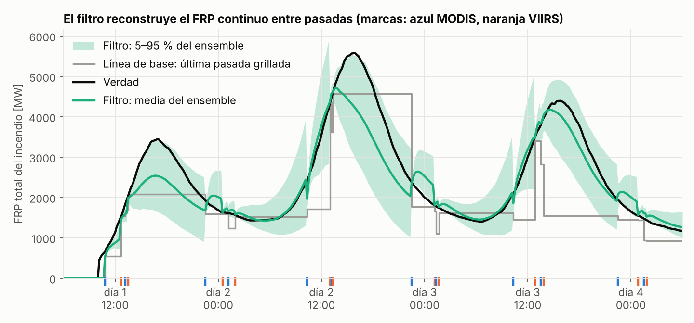
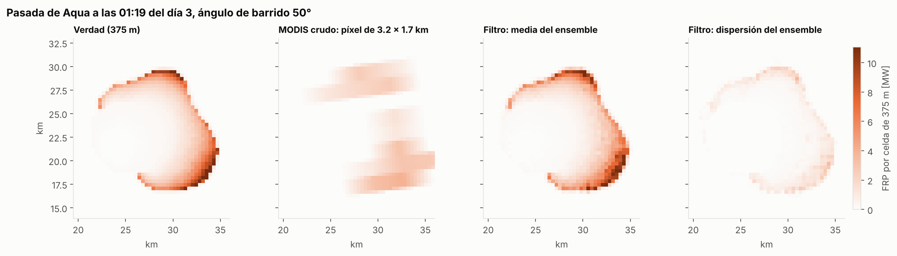
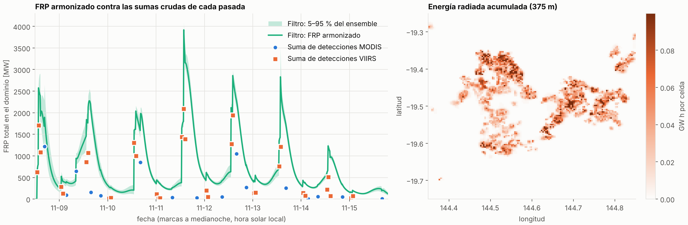
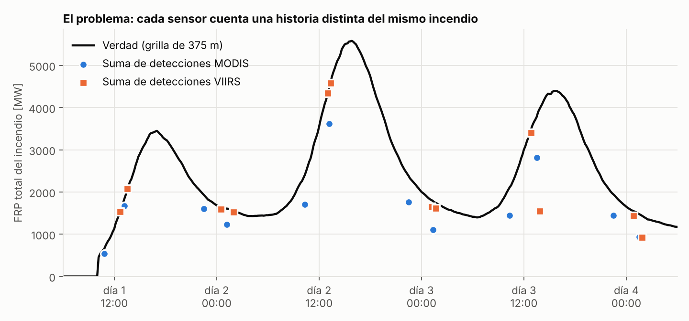

# Armonización MODIS–VIIRS con un filtro de Kalman por ensembles

Prototipo para el reto de NASA Space Apps de armonización de MODIS y VIIRS.
En vez de buscar una tabla de conversión entre sensores, mantiene un **estado
oculto del incendio** en una grilla de 375 m (potencia radiativa del fuego, FRP,
en MW por celda) y lo corrige con cada pasada satelital usando un **operador de
observación distinto para cada sensor**.

El resultado es un campo de FRP continuo en el tiempo, independiente del sensor
y con su incertidumbre.



## Qué hace

| Pieza | Archivo | Idea |
|---|---|---|
| Modelo de fuego | `frp_enkf/model.py` | Cada celda tiene FRP y combustible. Una celda encendida tiende a una intensidad de equilibrio fijada por su combustible y la hora del día, con un techo. Una celda apagada solo se enciende por contagio de sus vecinas, con viento. |
| Sensores | `frp_enkf/sensors.py` | Geometría real del píxel según el ángulo de barrido. MODIS pasa de 1 km en nadir a 4.8 × 2.0 km en el borde, con respuesta triangular. VIIRS pasa de 375 m a unos 0.8 km gracias a su agregación de muestras. El umbral de detección crece con el área del píxel. |
| LETKF | `frp_enkf/letkf.py` | Filtro de Kalman por ensembles con transformación local y localización de Gaspari-Cohn. |
| Fusión | `frp_enkf/assim.py` | Análisis en `log(FRP)`, no-detecciones como observaciones censuradas, encendido de fuego nuevo, y estimación en línea del sesgo MODIS/VIIRS, del viento efectivo y de las tasas del modelo. |
| Experimento | `frp_enkf/osse.py` | Incendio sintético con verdad conocida, pasadas simuladas de Terra, Aqua, S-NPP y NOAA-20, y métricas. |
| Calibración | `frp_enkf/calibrate.py` | Saca de las detecciones de VIIRS el techo de intensidad por celda y el piso nocturno del ciclo diurno. |
| Datos reales | `frp_enkf/firms.py` | Descarga de NASA FIRMS, lectura de los CSV, separación en pasadas y conversión de cada detección a su huella real. |

Tres decisiones separan esto de un EnKF de libro:

1. **Espacio logarítmico.** El FRP es positivo y muy asimétrico. El análisis se
   hace sobre `log(x + ε)`, así nunca aparecen MW negativos.
2. **La no-detección es un dato.** Un píxel despejado sin detección dice "el FRP
   está por debajo del umbral". Se asimila con un operador recortado en el
   umbral, que solo corrige a los miembros que predicen fuego detectable. Los
   píxeles nublados no aportan nada.
3. **El combustible sigue al fuego.** El LETKF aplica los mismos pesos locales
   al FRP y al combustible de cada celda, así que corregir dónde está el fuego
   corrige también qué queda por quemar.

Cuando llega un píxel MODIS grande, el filtro no lo deforma ni lo reparte
parejo. Lo compara con la integral del estado fino sobre esa huella, y la
covarianza del ensemble lleva la corrección a las celdas donde ya había fuego.



## Cómo correrlo

```bash
pip install -r requirements.txt
python run_osse.py            # ~1 minuto; escribe figures/ y figures/metrics.json
python -m pytest -q           # 35 tests
```

Opciones: `--seed`, `--members`, `--hours`, `--out`, `--no-figures`.
Conviene exportar `OMP_NUM_THREADS=1`: las matrices del filtro son chicas y los
hilos de BLAS lo hacen más lento.

## Resultados

Incendio sintético de 72 horas. El filtro arranca sin saber que hay fuego y usa
un modelo deliberadamente mal calibrado: contagio, techo de intensidad y tiempo
de residencia 15 % distintos de los reales, viento distinto, máximo diurno una
hora antes y un mapa de combustible con error. La línea de base es el mapa
grillado de la última pasada, mantenido hasta la siguiente. Las métricas se
miden desde 6 horas después de la primera pasada.

Escenario por defecto (`--seed 7`, 50 miembros):

| Sensores | Método | RMSE a 375 m [MW] | RMSE a 1.5 km [MW] | Error medio del FRP total |
|---|---|---|---|---|
| MODIS + VIIRS | Filtro | **0.68** | **0.37** | 12.5 % |
| MODIS + VIIRS | Línea de base | 1.70 | 1.31 | 27.6 % |
| Solo VIIRS | Filtro | 0.87 | 0.54 | 19.9 % |
| Solo VIIRS | Línea de base | 1.90 | 1.51 | 30.8 % |
| Solo MODIS | Filtro | 0.84 | 0.46 | **9.8 %** |
| Solo MODIS | Línea de base | 1.52 | 1.16 | 29.0 % |

Lo mismo con otras tres semillas (filtro contra línea de base, MODIS + VIIRS):

| Semilla | RMSE a 375 m | Error del FRP total | Sesgo MODIS (real: 0.80) | Viento (real: 0.30, 0.10) |
|---|---|---|---|---|
| 7 | 0.68 contra 1.70 | 12.5 % contra 27.6 % | 0.78 | 0.11, 0.09 |
| 1 | 0.62 contra 1.53 | 16.6 % contra 22.9 % | 0.74 | 0.20, 0.21 |
| 2 | 0.70 contra 1.71 | 15.7 % contra 25.2 % | 0.78 | 0.18, 0.11 |
| 3 | 0.68 contra 1.79 | 12.6 % contra 24.6 % | 0.79 | 0.25, 0.24 |

El filtro arranca con un viento supuesto de (0.10, 0.25).

Qué muestran:

- **El mapa a 375 m mejora siempre.** El error por celda es menos de la mitad
  que el de la línea de base, y con los dos sensores es menor que con cualquiera
  por separado, en las cuatro semillas.
- **El FRP total mejora, con margen variable.** Va de 23 % a 17 % en la peor
  semilla y de 28 % a 12.5 % en la mejor.
- **El sesgo entre sensores se recupera.** MODIS se simula con un sesgo
  multiplicativo de 0.80. El filtro lo estima entre 0.74 y 0.79, con una
  incertidumbre declarada de 4 a 5 %; la semilla 1 queda a dos desvíos.
- **El viento se recupera a medias.** En cada semilla al menos una de las dos
  componentes se acerca al valor real, pero en ninguna se recuperan las dos. Con la inferencia activa el error a 375 m baja entre
  3 y 7 % respecto de dejar el viento fijo.
- **La incertidumbre está razonablemente calibrada.** La dispersión del
  ensemble es entre 1.0 y 1.2 veces el error real.

### Sesgo de MODIS: solo con pasadas casi simultáneas

El sesgo `b` se actualiza únicamente cuando una pasada MODIS y una VIIRS caen a
menos de 45 minutos (por ejemplo Aqua con S-NPP), en cualquier orden. Ahí el
VIIRS ancla el estado y la diferencia con MODIS es sesgo. Con una pasada MODIS
aislada la diferencia es sobre todo error del modelo, y el sesgo queda
congelado. En el experimento hay 5 o 6 de esos pares en 72 horas.

### Viento efectivo: del corrimiento del centroide

Cada miembro del ensemble propaga el fuego con su propio viento, así que su
centroide de FRP pronosticado queda corrido en esa dirección. Al llegar una
pasada VIIRS, la regresión del ensemble entre esos centroides y el observado
corrige las dos componentes del viento, que son parámetros globales.


## Datos reales de NASA FIRMS

`run_firms.py` baja las detecciones de MODIS y VIIRS de un rectángulo, las
separa en pasadas y corre el filtro. Hay tres formas de darle datos:

```bash
# últimos 7 días, sin clave (archivos globales de FIRMS)
python run_firms.py --bbox 144.35,-19.75,144.85,-19.25 --recent 7d

# cualquier fecha, con la MAP_KEY gratuita de FIRMS
export FIRMS_MAP_KEY=...      # https://firms.modaps.eosdis.nasa.gov/api/map_key/
python run_firms.py --bbox 144.35,-19.75,144.85,-19.25 --start 2026-11-08 --days 7

# sin red, con los CSV de muestra incluidos
python run_firms.py --bbox 144.35,-19.75,144.85,-19.25 --csv-dir data/queensland_2026-11
```

El rectángulo es `oeste,sur,este,norte` en grados. Escribe en `salida_firms/`
la serie de FRP total (`frp_armonizado.csv`), los campos horarios a 375 m
(`frp_armonizado.npz`), un resumen (`resumen.json`) y una figura. Las descargas
se guardan en `.firms_cache/`. Una corrida de 7 días sobre 50 × 55 km tarda
algo más de un minuto.

Qué hace con cada detección:

- **Huella real.** Usa las columnas `scan` y `track` de FIRMS como tamaño del
  píxel y lo orienta según la órbita del satélite.
- **Hora solar.** Convierte la hora UTC a hora solar local para el ciclo diurno.
- **No-detecciones inferidas.** FIRMS solo lista detecciones. Para cada pasada
  con al menos una detección se asume que el resto del rectángulo estaba
  despejado y sin fuego detectable. No hay máscara de nubes, así que estas
  observaciones entran con el doble de error. `--no-non-detections` las apaga.

`run_firms.py` hace además tres cosas pensadas para datos reales:

- **Calibra el modelo con las detecciones.** El techo de intensidad por celda es
  el percentil 90 del FRP de los píxeles VIIRS diurnos cercanos al nadir, y el
  piso nocturno sale del cociente noche/día. `--no-calibration` lo apaga.
- **Ajusta en línea** el contagio, el techo y el tiempo de residencia con el FRP
  total de cada pasada.
- **Sesgo y viento.** `--bias-max-gap-min` cambia el umbral de 45 minutos.
  `--estimate-wind` activa la inferencia de viento, que viene apagada porque
  solo tiene sentido si el rectángulo contiene un único incendio.
- **Valida con un satélite reservado.** Con `--holdout NOAA-21` esas pasadas no
  se asimilan: se comparan con lo que el filtro predecía y con la persistencia
  (la última pasada asimilada).

### Prueba con un incendio real

Queensland, Australia, del 8 al 15 de noviembre de 2026: 48 pasadas (16 de
MODIS y 32 de VIIRS de NOAA-20 y NOAA-21) con 2555 detecciones. Los CSV están
en `data/queensland_2026-11/`. La calibración dio un techo de 17.4 MW por celda
y un piso nocturno de 0.19.



Validación reservando NOAA-21 (16 pasadas que el filtro nunca vio):

| | Filtro | Persistencia |
|---|---|---|
| Error mediano del FRP total de la pasada | **×2.6** | ×3.7 |
| Píxeles con fuego acertados | 405 | 364 |
| Píxeles con fuego omitidos | 710 | 751 |
| Falsas alarmas | 849 | 664 |
| Índice de acierto (CSI) | 0.21 | 0.20 |

El error del FRP total varió entre ×2.3 y ×2.6 en corridas con cambios mínimos,
así que la ventaja sobre la persistencia es real pero su tamaño no está bien
medido. Falta repetir la validación con varias semillas.

Qué muestra:

- **El FRP total se pronostica mejor que con persistencia**, tanto contra el
  satélite reservado como al llegar cada pasada asimilada (factor 1.9 contra 6.7
  en MODIS, y 3.1 contra 3.4 en VIIRS).
- **La ubicación píxel a píxel no mejora.** El índice de acierto es casi igual
  al de la persistencia, y el filtro da más falsas alarmas.
- **Todavía sobrestima, aunque la mitad que antes.** El pico del FRP total es de
  3900 MW contra 2090 MW de la mayor suma de una pasada. Con el modelo anterior
  era de 7600 MW. Los picos aparecen justo después de las pasadas de la tarde:
  el fuego nuevo se suma al que el filtro ya tenía en celdas vecinas. De noche
  el filtro mantiene unos 300 MW donde los satélites ven menos de 200.
- **La banda de incertidumbre es demasiado angosta** para los errores que se
  ven. No hay que leerla como un intervalo de confianza.
- **El sesgo MODIS/VIIRS no se pudo estimar.** En esta semana no hay ningún par
  MODIS–VIIRS a menos de 45 minutos: el más cercano está a 75, y FIRMS no trae
  detecciones de S-NPP. Con la regla de pasadas casi simultáneas el sesgo queda
  en su valor inicial de 1.
- **La inferencia de viento no es fiable aquí.** Dio direcciones opuestas según
  se reservara o no NOAA-21 (hacia 137° y hacia 340°). El rectángulo contiene
  varios focos, y el centroide global se mueve por encendidos y apagados, no
  por viento. Los resultados de arriba son con el viento fijo.

## Límites

- **Es un experimento gemelo.** La verdad y el filtro usan la misma familia de
  modelo, con parámetros distintos. Con incendios reales el error de modelo es
  mayor y la ventaja sobre la línea de base será menor.
- **Con datos reales el modelo de fuego sigue siendo el punto débil.** Está
  calibrado con un solo incendio y no tiene meteorología ni mapa de
  combustible. Falta probarlo en más incendios y sumar datos geoestacionarios
  para cubrir el hueco entre pasadas.
- **Las no-detecciones reales son una aproximación.** Para hacerlo bien hacen
  falta la cobertura del barrido y la máscara de nubes de los productos de
  nivel 2 (MOD14 y VNP14IMG).
- **VIIRS está simplificado.** En el producto real, el FRP de 375 m se calcula
  con la banda M13 de 750 m y se comparte entre detecciones vecinas. Aquí cada
  píxel I mide su propio FRP.
- **El sesgo de MODIS es un único factor constante.** No depende del ángulo de
  barrido ni de la hora. Con solo MODIS no se puede estimar y queda fijo en 1.
- **El modelo de fuego es un juguete.** No hay topografía, humedad ni viento
  variable, y el solapamiento entre barridos consecutivos de MODIS no está
  representado.


